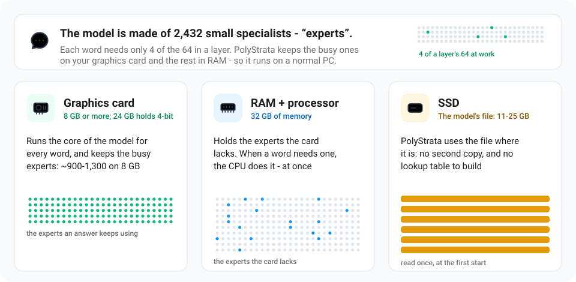

<h1 align="center">PolyStrata</h1>

[English](README.md) · [简体中文](README.zh-CN.md) · [日本語](README.ja.md) · [Deutsch](README.de.md) · [Français](README.fr.md) · [Español](README.es.md) · **Português**

<p align="center"><b>Rode modelos de IA grandes no seu próprio PC</b><br>
Qwen3.8-Flash-Next, GLM 5.3 Flash, DeepSeek V4 Flash, Qwen3.6, Ornith 1.5, Gemma 4 e Tiel Coder · gratuito e de código aberto</p>

<p align="center"></p>

<p align="center"><br>
<sub>Claude Code com Qwen3.6-35B-A3B UD-Q3_K_M no notebook com a placa de 8 GB, em tempo real: ele adiciona uma opção <code>--json</code> a um programa pequeno, escreve um teste e roda os testes. O servidor tinha lido o prompt de sistema do Claude Code ao iniciar (<code>"warm_start": true</code>).</sub></p>

<p align="center"><a href="https://github.com/Niko1221/Strata/releases/download/v0.1.10/Pagoda.mp4"></a><br>
<sub>Um jardim com pagode em voxels, feito com um único prompt numa RTX 5070 com o <a href="https://github.com/Niko1221/Strata">Strata</a> (Qwen3.8-Flash-Next IQ3_S, contexto de 128K) ·
<a href="https://github.com/Niko1221/Strata/releases/download/v0.1.10/Pagoda.mp4">vídeo completo (49 s)</a></sub></p>

O PolyStrata roda modelos de IA grandes num PC comum, modelos que normalmente precisam de um servidor.
Eles conversam, escrevem código e funcionam com seus apps e agentes de programação. Nada sai do seu PC.

Ele roda oito modelos, com dois motores:

- **[Qwen3.8-Flash-Next](https://huggingface.co/Qwen/Qwen3.8-Flash-Next)** numa placa de vídeo NVIDIA ou AMD de
  12 GB ou mais, no Windows ou no Linux. Ele também entende imagens. O motor dele é o do
  [Strata](https://github.com/Niko1221/Strata), sem mudanças.

Os outros sete usam um motor escrito para o PolyStrata, com uma placa NVIDIA ou [duas](docs/MULTI_GPU.md#the-strata-poly-models): os sete no Linux, e os cinco menores
também no Windows. São experimentais: só rodaram em um PC com uma placa de 32 GB, e os cinco menores também em um
notebook com uma placa de 8 GB.

- **[GLM 5.3 Flash](docs/GLM.md)**, o maior: um arquivo de 79 a 114 GB, que fica na maior parte na RAM.
- **[DeepSeek V4 Flash](docs/DEEPSEEK.md)**, um arquivo de 91 GB, que também fica na maior parte na RAM. A memória que
  ele guarda de uma conversa é pequena: um contexto de 128K ocupa só 0,7 GB de VRAM a mais que um de 32K.
- **[LFM2.5-24B-A2B](docs/LFM.md)** da Liquid AI, um arquivo de 11 a 25 GB. A maioria das camadas dele não tem
  atenção, então uma conversa longa ocupa pouca VRAM: um contexto de 128K ocupa só 2 GB a mais que 32K. A licença
  dele só permite o uso comercial a empresas que faturam menos de 10 milhões de dólares por ano.
- **[Qwen3.6-35B-A3B](docs/BACKENDS.md)**, um arquivo de 13 a 23 GB. Ele também entende imagens.
- **[Ornith 1.5](docs/BACKENDS.md)**, com a arquitetura do Qwen3.6-35B-A3B e outros pesos: um arquivo de 14 a 24 GB. Ele
  também entende imagens.
- **[Gemma 4 26B-A4B](docs/BACKENDS.md)**, um arquivo de 11 a 17 GB. Ele também entende imagens.
- **[Tiel Coder 35B-A3B](docs/BACKENDS.md)**, o Ornith 1.5 quantizado por peculiar-ragdoll para agentes de
  programação: um arquivo de 14 a 23 GB. Ele também entende imagens.

O servidor pode trocar entre os modelos instalados enquanto está rodando
([como](docs/BACKENDS.md#changing-the-model), em inglês).

O PolyStrata é feito sobre o [Strata](https://github.com/Niko1221/Strata) de Niko1221.
Por que é um repositório separado, placas AMD e menores, fine-tunes e outras perguntas: [FAQ](docs/FAQ.md) (em inglês).

## Qual é a velocidade?

Um token é mais ou menos ¾ de uma palavra.

- **Escreve respostas:** a velocidade com que a resposta aparece numa conversa curta. 60 tokens por segundo é mais rápido do que você consegue ler.
- **Lê seu prompt:** a velocidade com que ele absorve o que você envia (aqui, um documento, código ou histórico de conversa de 32K tokens).

### Qwen3.8-Flash-Next

Medido pelo [Strata](https://github.com/Niko1221/Strata) em dois PCs gamer comuns, com um prompt de 32K tokens.

<table>
<tr><th>NVIDIA: RTX 5070 (12 GB), Ryzen 5 7600, 64 GB de RAM</th><th>AMD: RX 9070 XT (16 GB), Ryzen 9 3900X, 47 GB de RAM</th></tr>
<tr><td>

| Tamanho | Escreve respostas | Lê seu prompt |
| --- | ---: | ---: |
| **Q2_0** | 94 tokens/s | 2,650 tokens/s |
| **IQ2_XS** | 79 tokens/s | 2,090 tokens/s |
| **IQ3_XXS** | 62 tokens/s | 1,750 tokens/s |
| **IQ3_S** | 53 tokens/s | 1,620 tokens/s |
| **Coder** | 55 tokens/s | 2,180 tokens/s |

</td><td>

| Tamanho | Escreve respostas | Lê seu prompt |
| --- | ---: | ---: |
| **Q2_0** | 60 tokens/s | 1,160 tokens/s |
| **IQ2_XS** | 52 tokens/s | 1,110 tokens/s |
| **Coder** | 44 tokens/s | 1,420 tokens/s |

</td></tr>
</table>

NVIDIA: Q2_0 com o engine 0.1.36, as outras linhas com 0.1.26 (respostas de 4K, prompts de 32K). As tabelas
completas estão em [DETAILS.md](docs/DETAILS.md#speed-measured). Uma placa com mais VRAM é mais rápida: uma
RTX 3090 (24 GB) deve escrever cerca de 100-140 tokens por segundo. Conversas longas e outras placas:
[velocidade de cada modelo](docs/MODELS.md#how-fast-is-each-size), [resultados da comunidade](docs/COMMUNITY_BENCHMARKS.md).

### GLM 5.3 Flash

Medido para o PolyStrata numa estação de trabalho, com uma conversa curta e um prompt de 29K tokens.

<table>
<tr><th>NVIDIA: RTX 5090 (32 GB), Xeon Platinum 8470Q (25 vCPU), 120 GB de RAM</th></tr>
<tr><td>

| Tamanho | Escreve respostas | Lê seu prompt |
| --- | ---: | ---: |
| **3.0BIT** | 59-66 tokens/s | 820 tokens/s |
| **UD-IQ2_XXS** | 50-52 tokens/s | 1,060-1,080 tokens/s |
| **REAP50-Q3_K_M** | 59-66 tokens/s | 1,300-1,310 tokens/s |

</td></tr>
</table>

O GLM 5.3 Flash é um modelo muito maior que os outros, e só cerca de um quinto dos experts dele cabe nos 32 GB desta placa, por isso
ele escreve mais devagar. O que foi medido e como: [docs/GLM.md](docs/GLM.md#what-it-was-measured-on) (em inglês).

### DeepSeek V4 Flash

Medido para o PolyStrata na mesma estação de trabalho, com uma conversa curta e um prompt de 30K tokens.

<table>
<tr><th>NVIDIA: RTX 5090 (32 GB), Xeon Platinum 8470Q (25 vCPU), 120 GB de RAM</th></tr>
<tr><td>

| Tamanho | Escreve respostas | Lê seu prompt |
| --- | ---: | ---: |
| **UD-IQ2_XXS** | 56 tokens/s | 1,040 tokens/s |

</td></tr>
</table>

No mesmo PC, o llama.cpp escrevia 25 a 28 tokens por segundo e lia um prompt de 3,384 tokens a 96. Um prompt de
116,473 tokens, num contexto de 128K, foi lido e respondido em 174 segundos, e um de 487,529 tokens, num contexto de
512K, em 32 minutos; nas duas vezes os três fatos escondidos nele foram encontrados. O que foi medido e como: [docs/DEEPSEEK.md](docs/DEEPSEEK.md#what-it-was-measured-on) (em inglês).

### LFM2.5-24B-A2B

Medido como o Qwen3.6-35B-A3B logo abaixo, nos mesmos dois PCs, com um prompt de cerca de 30,000 tokens.

<table>
<tr><th>NVIDIA: RTX 4070 Laptop (8 GB), Core i7-14700HX, 32 GB de RAM</th><th>NVIDIA: RTX 5090 (32 GB), Xeon Platinum 8470Q (25 vCPU), 120 GB de RAM</th></tr>
<tr><td>

| Tamanho | Escreve respostas | Lê seu prompt |
| --- | ---: | ---: |
| **UD-Q4_K_XL** | 70-73 tokens/s | 3,590-3,620 tokens/s |
| **UD-Q3_K_XL** | 88 tokens/s | 3,760-3,810 tokens/s |
| **QAD-Q4_0** | 77-78 tokens/s | 3,720-3,730 tokens/s |
| **UD-Q6_K_XL** | 42-43 tokens/s | 3,030-3,120 tokens/s |
| **Q8_0** | 23-34 tokens/s | 2,950-3,040 tokens/s |

</td><td>

| Tamanho | Escreve respostas | Lê seu prompt |
| --- | ---: | ---: |
| **UD-Q4_K_XL** | 480-485 tokens/s | 23,390-23,460 tokens/s |
| **UD-Q3_K_XL** | 490-497 tokens/s | 22,920-23,400 tokens/s |
| **QAD-Q4_0** | 498 tokens/s | 23,880-23,900 tokens/s |
| **UD-Q6_K_XL** | 423-426 tokens/s | 21,250-21,270 tokens/s |
| **Q8_0** | 376 tokens/s | 23,270-23,350 tokens/s |

</td></tr>
</table>

No notebook o Q8_0 enche os 32 GB de RAM, e por isso é lento lá; a estação de trabalho guarda inteiro cada tamanho.

No notebook o llama.cpp b11540 com `--n-cpu-moe 25`, o melhor dos ajustes testados lá, leu um prompt de 32,000 tokens
a 530 tokens/s e escreveu depois a 53; o PolyStrata o leu a 3,540 e escreveu a 71-73. Na estação de trabalho o
llama-bench leu 29,816 tokens a 13,300 tokens/s com o lote padrão do llama.cpp, de 512, e a 23,600 com 2,048, tão
rápido quanto o PolyStrata, e escreveu token a token a 455 tokens/s, e a 369 depois desse prompt; o PolyStrata escreve
a 452 e 387. Um prompt de cerca de 124,000 tokens em um contexto de 128K foi lido e respondido em 8,7 segundos na
estação de trabalho; o notebook o leu em 45 segundos.

### Qwen3.6-35B-A3B

Medido pelo PolyStrata em dois PCs, com uma conversa curta e um prompt de 30,000 a 32,000 tokens: à esquerda um
notebook com uma placa de 8 GB, onde o processador calcula os experts que não cabem na placa, e à direita uma estação
de trabalho cuja placa guarda o modelo inteiro.

<table>
<tr><th>NVIDIA: RTX 4070 Laptop (8 GB), Core i7-14700HX, 32 GB de RAM</th><th>NVIDIA: RTX 5090 (32 GB), Xeon Platinum 8470Q (25 vCPU), 120 GB de RAM</th></tr>
<tr><td>

| Tamanho | Escreve respostas | Lê seu prompt |
| --- | ---: | ---: |
| **UD-Q3_K_M** | 94-100 tokens/s | 1,690 tokens/s |
| **UD-Q2_K_XL** | 123-124 tokens/s | 1,590 tokens/s |
| **UD-Q4_K_M** | 82-86 tokens/s | 1,560-1,570 tokens/s |

</td><td>

| Tamanho | Escreve respostas | Lê seu prompt |
| --- | ---: | ---: |
| **UD-Q3_K_M** | 394-395 tokens/s | 7,800-7,810 tokens/s |
| **UD-Q2_K_XL** | 450 tokens/s | 7,720-7,740 tokens/s |
| **UD-Q4_K_M** | 395-396 tokens/s | 8,070-8,080 tokens/s |

</td></tr>
</table>

Um prompt de 10,000 tokens é lido a 1,660 tokens/s no notebook e a 6,300 na estação de trabalho.
Os números da placa da estação limitada a 8
GB, um substituto de antes da medição no notebook, estão em [docs/BACKENDS.md](docs/BACKENDS.md#with-8-gb-of-vram) (em
inglês).

### Ornith 1.5

Medido do mesmo jeito, nos mesmos dois PCs.

<table>
<tr><th>NVIDIA: RTX 4070 Laptop (8 GB), Core i7-14700HX, 32 GB de RAM</th><th>NVIDIA: RTX 5090 (32 GB), Xeon Platinum 8470Q (25 vCPU), 120 GB de RAM</th></tr>
<tr><td>

| Tamanho | Escreve respostas | Lê seu prompt |
| --- | ---: | ---: |
| **APEX-I-COMPACT** | 76-82 tokens/s | 1,620 tokens/s |
| **APEX-I-MINI** | 80-86 tokens/s | 1,550-1,560 tokens/s |
| **APEX-I-QUALITY** | 59-63 tokens/s | 1,570-1,580 tokens/s |

</td><td>

| Tamanho | Escreve respostas | Lê seu prompt |
| --- | ---: | ---: |
| **APEX-I-COMPACT** | 316-319 tokens/s | 8,040-8,110 tokens/s |
| **APEX-I-MINI** | 289-300 tokens/s | 7,710-7,740 tokens/s |
| **APEX-I-QUALITY** | 297-302 tokens/s | 7,860-7,880 tokens/s |

</td></tr>
</table>

Um prompt de 10,000 tokens é lido a 1,590 tokens/s no notebook e a 6,400 na estação de trabalho.

### Gemma 4 26B-A4B

Medido do mesmo jeito, nos mesmos dois PCs.

<table>
<tr><th>NVIDIA: RTX 4070 Laptop (8 GB), Core i7-14700HX, 32 GB de RAM</th><th>NVIDIA: RTX 5090 (32 GB), Xeon Platinum 8470Q (25 vCPU), 120 GB de RAM</th></tr>
<tr><td>

| Tamanho | Escreve respostas | Lê seu prompt |
| --- | ---: | ---: |
| **UD-Q3_K_M** | 92-93 tokens/s | 2,240 tokens/s |
| **UD-Q2_K_XL** | 101-104 tokens/s | 2,150-2,160 tokens/s |
| **UD-Q4_K_M** | 85 tokens/s | 2,150 tokens/s |

</td><td>

| Tamanho | Escreve respostas | Lê seu prompt |
| --- | ---: | ---: |
| **UD-Q3_K_M** | 353-356 tokens/s | 8,420-8,480 tokens/s |
| **UD-Q2_K_XL** | 332-338 tokens/s | 7,940-7,970 tokens/s |
| **UD-Q4_K_M** | 335-346 tokens/s | 8,320-8,390 tokens/s |

</td></tr>
</table>

Um prompt de 10,000 tokens é lido a 2,130 tokens/s no notebook e a 6,800 na estação de trabalho.

### Tiel Coder 35B-A3B

Medido do mesmo jeito, nos mesmos dois PCs.

<table>
<tr><th>NVIDIA: RTX 4070 Laptop (8 GB), Core i7-14700HX, 32 GB de RAM</th><th>NVIDIA: RTX 5090 (32 GB), Xeon Platinum 8470Q (25 vCPU), 120 GB de RAM</th></tr>
<tr><td>

| Tamanho | Escreve respostas | Lê seu prompt |
| --- | ---: | ---: |
| **UD-Q3_K_XL** | 83 tokens/s | 1,700 tokens/s |
| **UD-IQ3_XXS** | 96-97 tokens/s | 1,610 tokens/s |
| **UD-Q4_K_XL** | 74-79 tokens/s | 1,660-1,670 tokens/s |

</td><td>

| Tamanho | Escreve respostas | Lê seu prompt |
| --- | ---: | ---: |
| **UD-Q3_K_XL** | 337-345 tokens/s | 8,080-8,110 tokens/s |
| **UD-IQ3_XXS** | 352 tokens/s | 7,520 tokens/s |
| **UD-Q4_K_XL** | 316-322 tokens/s | 7,750-7,970 tokens/s |

</td></tr>
</table>

Um prompt de 10,000 tokens é lido a 1,670 tokens/s no notebook e a 6,300 na estação de trabalho.

Os sete modelos do motor próprio do PolyStrata foram medidos com o benchmark dele, que você pode rodar no seu PC:
`python polystrata.py benchmark --model <name> --prompt-tokens 24000`
([o que ele envia e mostra](docs/BACKENDS.md#benchmark), em inglês).
O que outras pessoas mediram nas próprias placas, e como comparar com o llama.cpp na sua:
[resultados da comunidade](docs/COMMUNITY_BENCHMARKS.md#the-models-polystrata-adds) (em inglês).
No notebook, o PolyStrata leu os prompts de 2.7 a 3.5 vezes mais rápido que o llama.cpp b11540 e escreveu de
1.5 a 1.8 vezes mais rápido, com o Qwen3.6 e com o Tiel Coder ([as duas medições](docs/COMMUNITY_BENCHMARKS.md#comparing-with-llamacpp), em inglês).

## Do que você precisa

### Qwen3.8-Flash-Next

| | |
| --- | --- |
| **Placa de vídeo** | **NVIDIA** GeForce RTX séries 20, 30, 40 ou 50, ou **AMD** Radeon RX 7900 XT / XTX, RX 7800 XT / 7700 XT, RX 9060 XT, RX 9070 / 9070 XT, Radeon AI PRO R9700 ou séries RX 6800 / 6900. Ela precisa de **12 GB de VRAM ou mais**. |
| **RAM** | 32 GB ou mais. Sua RAM decide [qual modelo](#qual-modelo-devo-escolher) cabe. Com 64 GB, roda qualquer tamanho. |
| **Disco** | Cerca de 80 GB livres. Use um SSD se puder: a primeira inicialização fica bem mais rápida. |
| **Sistema** | Windows 10 / 11 ou Linux, e um driver de vídeo atualizado da NVIDIA ou da AMD. |

O instalador cuida de todo o resto. Duas ou três placas podem dividir o modelo ([multi-GPU](docs/MULTI_GPU.md)).

Experimental, escrito e testado por membros da comunidade nas próprias máquinas:

- **Placas de vídeo mais antigas** (Tesla P40 / V100, GTX 10, Radeon VII / MI50, RX 6700 XT, RX 5500 XT): [Older GPUs](docs/OLDER_GPUS.md).
- **Intel Arc**, compilado a partir do código-fonte no Linux: [Intel Arc](docs/INTEL_ARC.md).
- **AMD Ryzen AI Max (Strix Halo)**, compilado a partir do código-fonte no Linux: [Strix Halo](docs/STRIX_HALO.md).
- **Processadores mais antigos sem AVX2**: funcionam, mas devagar. [Older CPUs](docs/INSTALL.md#older-cpus-experimental).

A lista completa: [docs/INSTALL.md](docs/INSTALL.md#what-you-need).

### GLM 5.3 Flash

| | |
| --- | --- |
| **Placa de vídeo** | Uma placa **NVIDIA** GeForce RTX série 20 ou mais nova. Ele só rodou com **32 GB de VRAM**. Cerca de 12 GB são ocupados antes do primeiro expert, então uma placa de 12 GB não consegue iniciá-lo. |
| **RAM** | Ao lado de uma placa de 32 GB, **96 GB ou mais** para o modelo inteiro, 82 GB para o tamanho de 2 bits, 60 GB para o tamanho com metade dos experts. Uma placa menor precisa de mais RAM ([quanto](#qual-modelo-devo-escolher)). Ele rodou com 120 GB. |
| **Disco** | 114 GB, 102 GB ou 79 GB para o arquivo do modelo, num SSD. |
| **Sistema** | Linux e um driver NVIDIA atual. |

O instalador cuida de todo o resto. Ele compila o motor no seu PC e oferece instalar o que falta para isso
(g++ e o CUDA Toolkit). Ainda não: placas AMD, duas placas no Windows, três placas ou mais, imagens.
Um usuário roda no Windows com uma placa de 24 GB e 128 GB de RAM ([relato](https://github.com/VecSzn/PolyStrata/issues/10)).

A lista completa: [docs/GLM.md](docs/GLM.md#what-you-need) (em inglês).

### DeepSeek V4 Flash

| | |
| --- | --- |
| **Placa de vídeo** | Uma placa **NVIDIA** GeForce RTX série 20 ou mais nova. Ele só rodou com **32 GB de VRAM**. Cerca de 11,5 GB são ocupados antes do primeiro expert, então uma placa de 12 GB não consegue iniciá-lo. |
| **RAM** | Ao lado de uma placa de 32 GB, **72 GB ou mais**, pela estimativa do instalador. Uma placa menor precisa de mais RAM ([quanto](#qual-modelo-devo-escolher)). Ele rodou com 120 GB. |
| **Disco** | 91 GB para os três arquivos do modelo, num SSD. |
| **Sistema** | Linux e um driver NVIDIA atual. |

O instalador cuida de todo o resto, como no GLM 5.3 Flash. Ainda não testado: Windows, placas AMD, duas placas. Ele só
lê texto.

A lista completa: [docs/DEEPSEEK.md](docs/DEEPSEEK.md#what-you-need) (em inglês).

### LFM2.5-24B-A2B

| | |
| --- | --- |
| **Placa de vídeo** | Uma placa **NVIDIA** GeForce RTX série 20 ou mais nova com **8 GB de VRAM ou mais**. Cerca de 4 GB são ocupados antes do primeiro expert. Ele rodou na placa de 8 GB de um notebook e numa placa de 32 GB. |
| **RAM** | Cerca de **16, 18, 20, 27 ou 31 GB** ao lado de uma placa de 8 GB para UD-Q3_K_XL, QAD-Q4_0, UD-Q4_K_XL, UD-Q6_K_XL e Q8_0, pela estimativa do instalador. Uma placa de 24 GB guarda inteiros os três tamanhos menores. Os cinco rodaram em um notebook com 32 GB. |
| **Disco** | 11 a 25 GB para o arquivo do modelo. |
| **Sistema** | Linux ou Windows 10 / 11, e um driver NVIDIA atual. |

O instalador cuida de todo o resto, como com o Qwen3.6-35B-A3B logo abaixo. Ainda não foi testado numa placa AMD. Ele
só lê texto. A licença da Liquid AI só permite o uso comercial a empresas que faturam menos de 10 milhões de dólares
por ano ([LFM Open License v1.0](https://huggingface.co/LiquidAI/LFM2.5-24B-A2B/blob/main/LICENSE)).

A lista completa: [docs/LFM.md](docs/LFM.md#what-you-need) (em inglês).

### Qwen3.6-35B-A3B

| | |
| --- | --- |
| **Placa de vídeo** | Uma placa **NVIDIA** GeForce RTX série 20 ou mais nova com **8 GB de VRAM ou mais**. Cerca de 5 GB são ocupados antes do primeiro expert. Ele rodou numa placa de 32 GB, nessa placa limitada a 8 GB e na placa de 8 GB de um notebook. No Linux uma placa AMD também roda, em beta: o instalador compila o motor no seu PC; testado até agora com Qwen3.6 e Ornith em uma RX 7600. |
| **RAM** | Cerca de **17, 21 ou 27 GB** ao lado de uma placa de 8 GB para os três tamanhos, pela estimativa do instalador. Uma placa de 24 GB guarda inteiros os dois tamanhos menores. Os três tamanhos rodaram em um notebook com 32 GB. |
| **Disco** | 13, 17 ou 23 GB para o arquivo do modelo, 1 GB a mais para ler imagens. |
| **Sistema** | Linux ou Windows 10 / 11, e um driver NVIDIA atual. |

O instalador cuida de todo o resto, como faz com o GLM 5.3 Flash. No Windows ele baixa o motor já compilado da
última versão publicada. Num processador sem AVX2, ou numa cópia cujo motor mudou depois dessa versão, ele compila o
motor no lugar, com o compilador de 2022 do Visual Studio e o CUDA Toolkit, e oferece instalar os dois. Ainda não:
placas AMD no Windows, duas placas no Windows, três placas ou mais.

Desde a 0.1.44, o próprio motor do [Strata](https://github.com/Niko1221/Strata) também roda o Qwen3.6, a partir do
UD-Q4_K_XL (`--family qwen36-strata`, 32 GB de RAM ou mais). Numa RTX 5090 com UD-Q4_K_XL, ele leu um prompt de 4K
1,6 vez mais rápido que o strata-poly; num prompt de 31K e na escrita os dois ficaram quase iguais
([medido](docs/BACKENDS.md#qwen36-on-two-engines), em inglês). Os tamanhos menores, para placas de 8 GB, continuam no strata-poly.

### Ornith 1.5

| | |
| --- | --- |
| **Placa de vídeo** | Uma placa **NVIDIA** GeForce RTX série 20 ou mais nova com **8 GB de VRAM ou mais**. Cerca de 4 GB são ocupados antes do primeiro expert. Ele rodou numa placa de 32 GB, nessa placa limitada a 8 GB e na placa de 8 GB de um notebook. No Linux uma placa AMD também roda, em beta: o instalador compila o motor no seu PC; testado até agora com Qwen3.6 e Ornith em uma RX 7600. |
| **RAM** | Cerca de **18, 22 ou 28 GB** ao lado de uma placa de 8 GB para os três tamanhos, pela estimativa do instalador. Uma placa de 24 GB guarda inteiros os dois tamanhos menores. Os três tamanhos rodaram em um notebook com 32 GB. |
| **Disco** | 14, 17 ou 24 GB para o arquivo do modelo, 1 GB a mais para ler imagens. |
| **Sistema** | Linux ou Windows 10 / 11, e um driver NVIDIA atual. |

O instalador cuida de todo o resto, como faz com o GLM 5.3 Flash. No Windows ele baixa o motor já compilado da
última versão publicada. Num processador sem AVX2, ou numa cópia cujo motor mudou depois dessa versão, ele compila o
motor no lugar, com o compilador de 2022 do Visual Studio e o CUDA Toolkit, e oferece instalar os dois. Ainda não:
placas AMD no Windows, duas placas no Windows, três placas ou mais.

### Gemma 4 26B-A4B

| | |
| --- | --- |
| **Placa de vídeo** | Uma placa **NVIDIA** GeForce RTX série 20 ou mais nova com **8 GB de VRAM ou mais**. Cerca de 6 GB são ocupados antes do primeiro expert. Ele rodou numa placa de 32 GB, nessa placa limitada a 8 GB e na placa de 8 GB de um notebook. No Linux uma placa AMD também roda, em beta: o instalador compila o motor no seu PC; testado até agora com Qwen3.6 e Ornith em uma RX 7600. |
| **RAM** | Cerca de **15, 18 ou 21 GB** ao lado de uma placa de 8 GB para os três tamanhos, pela estimativa do instalador. Pela mesma estimativa, uma placa de 16 GB guarda inteiros os dois tamanhos menores. Os três tamanhos rodaram em um notebook com 32 GB. |
| **Disco** | 11, 13 ou 17 GB para o arquivo do modelo e o modelo de rascunho dele, 1 GB a mais para ler imagens. |
| **Sistema** | Linux ou Windows 10 / 11, e um driver NVIDIA atual. |

O instalador cuida de todo o resto, como faz com o GLM 5.3 Flash. No Windows ele baixa o motor já compilado da
última versão publicada. Num processador sem AVX2, ou numa cópia cujo motor mudou depois dessa versão, ele compila o
motor no lugar, com o compilador de 2022 do Visual Studio e o CUDA Toolkit, e oferece instalar os dois. Ainda não:
placas AMD no Windows, duas placas no Windows, três placas ou mais.

### Tiel Coder 35B-A3B

| | |
| --- | --- |
| **Placa de vídeo** | Uma placa **NVIDIA** GeForce RTX série 20 ou mais nova com **8 GB de VRAM ou mais**. Cerca de 5 GB são ocupados antes do primeiro expert. Ele rodou numa placa de 32 GB, nessa placa limitada a 8 GB e na placa de 8 GB de um notebook. No Linux uma placa AMD também roda, em beta: o instalador compila o motor no seu PC; testado até agora com Qwen3.6 e Ornith em uma RX 7600. |
| **RAM** | Cerca de **18, 21 ou 27 GB** ao lado de uma placa de 8 GB para os três tamanhos, pela estimativa do instalador. Uma placa de 24 GB guarda inteiros os três tamanhos. Os três tamanhos rodaram em um notebook com 32 GB. |
| **Disco** | 14, 17 ou 23 GB para o arquivo do modelo, 1 GB a mais para ler imagens. |
| **Sistema** | Linux ou Windows 10 / 11, e um driver NVIDIA atual. |

O instalador cuida de todo o resto, como faz com o GLM 5.3 Flash. No Windows ele baixa o motor já compilado da
última versão publicada. Num processador sem AVX2, ou numa cópia cujo motor mudou depois dessa versão, ele compila o
motor no lugar, com o compilador de 2022 do Visual Studio e o CUDA Toolkit, e oferece instalar os dois. Ainda não:
placas AMD no Windows, duas placas no Windows, três placas ou mais.

Do que cada um dos quatro precisa e como foi conferido: [docs/BACKENDS.md](docs/BACKENDS.md#install) (em inglês).

## Instalação

### Deixe sua IA instalar

Você usa um assistente de programação com IA (Claude Code, Cursor, Codex, GitHub Copilot, ...)? Cole isto nele:

```text
Set up PolyStrata on this PC for me: https://github.com/VecSzn/PolyStrata - follow docs/AI_SETUP.md in that repository.
```

Ele verifica sua placa de vídeo, RAM e disco e escolhe o modelo que cabe. Depois instala, inicia e explica como
conectar seus apps. Ferramentas de IA também podem instalar, iniciar e parar o PolyStrata pelo
[servidor MCP](docs/MCP_SERVER.md) dele.

### Ou faça você mesmo

[Baixe o PolyStrata](https://github.com/VecSzn/PolyStrata/archive/refs/heads/main.zip) e descompacte (ou use `git clone`).
**Windows:** clique duas vezes em **`START-HERE.bat`**. **Linux:** rode **`./setup.sh`** na pasta do PolyStrata.

**Mac (Apple Silicon, M1 a M5, macOS 15 ou mais recente):** instale uma vez as Command Line Tools da Apple (`xcode-select --install` no Terminal; o Xcode em si não é necessário). Depois abra o Terminal na pasta do PolyStrata e rode **`./setup.sh`**. Ele compila o motor do Mac no seu Mac (uns 7 minutos), faz as mesmas perguntas, baixa o modelo e o inicia. Da próxima vez, `./setup.sh` inicia na hora. Qual tamanho cabe no seu Mac e qual a velocidade: [docs/MAC.md](docs/MAC.md).

Os passos são os mesmos para NVIDIA e AMD. O instalador encontra sua placa e configura o engine certo para ela.
Ele faz algumas perguntas:

- qual modelo e qual tamanho,
- quanto contexto (quanto texto o modelo guarda na memória),
- se ele deve entender imagens (o GLM 5.3 Flash, o DeepSeek V4 Flash e o LFM2.5 não entendem).

Aperte Enter em cada uma para usar a resposta recomendada. Depois ele baixa o modelo (cerca de 70 GB para o
Qwen3.8-Flash-Next, 79 a 114 GB para o GLM 5.3 Flash, 91 GB para o DeepSeek V4 Flash, 11 a 25 GB para os outros cinco) e o inicia.
Se o download parar, rode de novo: ele continua de onde parou. Seu navegador abre o app do PolyStrata em
`http://127.0.0.1:8080`.

Os oito estão na lista de modelos do instalador. `./setup.sh --family glm`, `deepseek`, `lfm25`, `qwen36`, `ornith`,
`gemma4` ou `tiel` vai direto para um deles ([o que ele pergunta e grava](docs/GLM.md#install), em inglês).

> **Enquanto o modelo inicia, seu PC pode ficar lento ou parar de responder por 1-3 minutos** (mais na primeira vez).
> O PolyStrata carrega 35-55 GB na sua RAM e reserva parte dela para a placa de vídeo. Isso é normal. Espere e não
> feche a janela. A janela mostra o que o PolyStrata está fazendo.

**Da próxima vez**, rode `START-HERE.bat` (ou `./setup.sh`) de novo. Ele inicia na hora e não baixa nada duas
vezes. Feche a janela para parar o modelo. `UPDATE.bat` (`./update.sh`) atualiza o PolyStrata sem iniciá-lo.
Atualização, Docker, várias placas, onde ficam os arquivos e todas as opções: [docs/INSTALL.md](docs/INSTALL.md).

**É rápido no seu PC?** Rode `BENCH.bat` (`./bench.sh`): uns 5-10 minutos; ele mede o chat, prompts de 4K/16K e uma sessão no estilo agente com as suas próprias configurações e escreve um relatório para compartilhar ([como](docs/COMMUNITY_BENCHMARKS.md#run-the-benchmark)).

## Qual modelo devo escolher?

### Qwen3.8-Flash-Next

O instalador recomenda um de acordo com sua RAM. O mesmo modelo vem em vários tamanhos, mais ou menos comprimidos.
Os tamanhos menores são mais rápidos. Os maiores são um pouco mais inteligentes.

| Sua RAM | Escolha | Por quê |
| --- | --- | --- |
| **32 GB** | **Coder** | cabe em 32 GB e é feito para código (com uma placa de 24 GB, Q2_0 e IQ2_XS também rodam) |
| **48 GB** | **IQ2_XS** (ou Q2_0, o mais rápido) | os tamanhos maiores não cabem |
| **64 GB** | **IQ2_XS** (recomendado), ou IQ3_XXS / IQ3_S | todos os tamanhos cabem; IQ3_S é o melhor e o mais lento |
| **96 GB ou mais** | **IQ3_S**, ou o UD-IQ4_XS da Unsloth (~4-bit) | espaço para os maiores tamanhos com todo o resto aberto |

- **[Coder](docs/MODELS.md#coder):** uma versão para programação com metade dos experts removida. Ela alcança 91%
  da pontuação do modelo completo no SWE-bench Verified (medido pelos autores) e cabe em 32 GB de RAM. É mais fraca
  fora do código, inclusive em chinês e outros textos CJK (#438). Para isso, escolha Q2_0, IQ2_XS ou IQ3_S, que
  mantêm todos os experts.
- **[Swift 1.5](docs/MODELS.md#swift-15):** um fine-tune que pensa por bem menos tempo antes de responder. Você
  recebe a resposta mais cedo, com quase a mesma qualidade.
- **[Unsloth UD-IQ4_XS](docs/MODELS.md#unsloth-ud-iq4_xs):** a versão de ~4 bits da Unsloth, entre IQ3_S e
  UD-Q4_K_XL em qualidade. Um download de 94 GB. Com menos de ~80 GB de RAM, o PolyStrata lê uma parte dele do SSD
  enquanto responde, então ali ele fica mais lento (um SSD NVMe ajuda).
- **[Unsloth UD-Q4_K_XL, UD-Q5_K_XL, UD-Q6_K_XL e Q8_0](docs/MODELS.md#unsloths-files-ud-iq4_xs-to-q8_0):** de 4 a 8 bits, mais próximos do modelo
  completo (93-95% o mesmo próximo token que o Q8_0). Rápidos quando todos os especialistas cabem na RAM (~88 GB para
  o UD-Q4_K_XL até ~136 GB para o Q8_0); com menos RAM, o PolyStrata lê uma parte do SSD enquanto responde, o que é bem
  mais lento (7-8.5 tokens/s para o UD-Q4_K_XL num PC com 64 GB).
- **[OrcaRouter's Uncensored IQ3_XXS](docs/MODELS.md#orcarouter-uncensored-iq3_xxs):** você configura à mão. Ele
  não está no menu do instalador.

Tamanhos, downloads e o que cabe onde: [docs/MODELS.md](docs/MODELS.md). Para adicionar outro modelo depois, rode
`SETUP.bat` (Linux: `./setup.sh --setup`).

### GLM 5.3 Flash

Três tamanhos por enquanto. O instalador escolhe o primeiro para o qual a sua RAM é suficiente.

| Tamanho | O que é | Download | RAM ao lado de uma placa de 32 GB |
| --- | --- | ---: | ---: |
| **3.0BIT** | o modelo inteiro, a cerca de 3 bits ([neuralll](https://huggingface.co/neuralll/GLM-5.3-Flash-GSQ-RCO-3.0bit-Q4Kattn-GGUF)) | 114 GB | 96 GB |
| **UD-IQ2_XXS** | o modelo inteiro, a cerca de 2 bits ([Unsloth](https://huggingface.co/unsloth/GLM-5.3-Flash-GGUF)): lê um prompt mais rápido e escreve mais devagar | 102 GB | 82 GB |
| **REAP50-Q3_K_M** | metade dos experts roteados removida ([REAP50](https://huggingface.co/patrickbdevaney/GLM-5.3-Flash-REAP50-GGUF), de patrickbdevaney) | 79 GB | 60 GB |

A RAM necessária depende da sua placa de vídeo: os experts que não cabem na placa precisam ficar na RAM.

| Sua placa de vídeo | 3.0BIT | UD-IQ2_XXS | REAP50-Q3_K_M | |
| --- | ---: | ---: | ---: | --- |
| **32 GB** | **96 GB** | **82 GB** | **60 GB** | o PC em que ele rodou (120 GB de RAM) |
| **24 GB** | cerca de 104 GB | cerca de 90 GB | cerca de 68 GB | ainda não testado |
| **16 GB** | cerca de 113 GB | cerca de 99 GB | cerca de 77 GB | ainda não testado |
| **12 GB ou menos** | | | | não inicia |

Os números de RAM são a estimativa do instalador, a partir do único PC em que ele rodou. Com menos RAM ele inicia
mesmo assim, mas lê experts do SSD enquanto responde e fica muito mais lento. O instalador avisa e pergunta antes.

As outras quantizações do GLM 5.3 Flash ainda não são suportadas: [o que falta](docs/GLM.md#what-is-missing) (em inglês).

### DeepSeek V4 Flash

Um tamanho só, por enquanto.

| Tamanho | O que é | Download | RAM ao lado de uma placa de 32 GB |
| --- | --- | ---: | ---: |
| **UD-IQ2_XXS** | o modelo inteiro, com cerca de 2 bits ([Unsloth](https://huggingface.co/unsloth/DeepSeek-V4-Flash-0731-GGUF)) | 91 GB | 72 GB |

Como no GLM 5.3 Flash, os experts que a placa não guarda ficam na RAM: pela estimativa do instalador, cerca de 80 GB ao
lado de uma placa de 24 GB e 89 GB ao lado de uma de 16 GB; uma placa de 12 GB não consegue iniciá-lo. Só a placa de
32 GB foi testada.

### LFM2.5-24B-A2B

Cinco tamanhos. O instalador escolhe UD-Q4_K_XL, ou UD-Q3_K_XL num PC com menos RAM. Os outros são escolhidos pelo nome: `--model QAD-Q4_0`.

| Tamanho | O que é | Download | RAM ao lado de uma placa de 8 GB |
| --- | --- | ---: | ---: |
| **UD-Q4_K_XL** | o modelo inteiro com experts de 4 bits ([Unsloth](https://huggingface.co/unsloth/LFM2.5-24B-A2B-GGUF)) | 15 GB | cerca de 20 GB |
| **UD-Q3_K_XL** | o mesmo com experts de 3 bits: o que pede menos RAM | 11 GB | cerca de 16 GB |
| **QAD-Q4_0** | 4 bits, da própria [Liquid AI](https://huggingface.co/LiquidAI/LFM2.5-24B-A2B-GGUF), treinado para perder menos com essa quantização | 14 GB | cerca de 18 GB |
| **UD-Q6_K_XL** | experts de 6 bits | 22 GB | cerca de 27 GB |
| **Q8_0** | 8 bits em tudo, o mais próximo do modelo como foi treinado | 25 GB | cerca de 31 GB |

Contra o Q8_0, em cinco prompts de 256 tokens cada, os outros tamanhos escolhem o token mais provável do Q8_0 em 96,8%
dos passos (UD-Q6_K_XL), 95,5% (UD-Q4_K_XL), 92,7% (QAD-Q4_0) e 91,6% (UD-Q3_K_XL).

### Qwen3.6-35B-A3B

Três tamanhos por enquanto. O instalador escolhe UD-Q3_K_M, ou UD-Q2_K_XL num PC com menos RAM. UD-Q4_K_M é escolhido pelo nome: `--model UD-Q4_K_M`.

| Tamanho | O que é | Download | RAM ao lado de uma placa de 8 GB |
| --- | --- | ---: | ---: |
| **UD-Q3_K_M** | o modelo inteiro com experts de 3 bits ([Unsloth](https://huggingface.co/unsloth/Qwen3.6-35B-A3B-MTP-GGUF)) | 17 GB | cerca de 21 GB |
| **UD-Q2_K_XL** | o mesmo com experts de 2 e 3 bits: o que pede menos RAM | 13 GB | cerca de 17 GB |
| **UD-Q4_K_M** | o mesmo com experts de 4 bits | 23 GB | cerca de 27 GB |

Uma placa maior guarda mais do modelo e precisa de menos RAM: com UD-Q3_K_M, cerca de 17 GB ao lado de uma placa de 12 GB, 13 GB ao lado de uma de 16 GB e 10 GB quando a placa guarda tudo. São estimativas do instalador. Elas não foram
conferidas num PC assim.

### Ornith 1.5

Três tamanhos por enquanto. O instalador escolhe APEX-I-COMPACT, ou APEX-I-MINI num PC com menos RAM. APEX-I-QUALITY é escolhido pelo nome: `--model APEX-I-QUALITY`.

| Tamanho | O que é | Download | RAM ao lado de uma placa de 8 GB |
| --- | --- | ---: | ---: |
| **APEX-I-COMPACT** | o modelo inteiro com experts de 3 e 4 bits ([APEX](https://huggingface.co/mudler/Ornith-1.5-35B-A3B-APEX-MTP-GGUF), de mudler) | 17 GB | cerca de 22 GB |
| **APEX-I-MINI** | o mesmo com experts de 2 e 3 bits: o que pede menos RAM | 14 GB | cerca de 18 GB |
| **APEX-I-QUALITY** | o mesmo com experts de 4 a 6 bits | 24 GB | cerca de 28 GB |

Uma placa maior guarda mais do modelo e precisa de menos RAM: com APEX-I-COMPACT, cerca de 17 GB ao lado de uma placa de 12 GB, 13 GB ao lado de uma de 16 GB e 10 GB quando a placa guarda tudo. São estimativas do instalador. Elas não foram
conferidas num PC assim.

### Gemma 4 26B-A4B

Três tamanhos por enquanto. O instalador escolhe UD-Q3_K_M, ou UD-Q2_K_XL num PC com menos RAM. UD-Q4_K_M é escolhido pelo nome: `--model UD-Q4_K_M`.

| Tamanho | O que é | Download | RAM ao lado de uma placa de 8 GB |
| --- | --- | ---: | ---: |
| **UD-Q3_K_M** | o modelo inteiro com experts de 3 bits ([Unsloth](https://huggingface.co/unsloth/gemma-4-26B-A4B-it-GGUF)), e o modelo de rascunho do Google para ele | 13 GB | cerca de 18 GB |
| **UD-Q2_K_XL** | o mesmo com experts de 2 bits: o que pede menos RAM | 11 GB | cerca de 15 GB |
| **UD-Q4_K_M** | o mesmo com experts de 4 e 5 bits | 17 GB | cerca de 21 GB |

Uma placa maior guarda mais do modelo e precisa de menos RAM: com UD-Q3_K_M, cerca de 14 GB ao lado de uma placa de 12 GB e 10 GB quando a placa guarda tudo. São estimativas do instalador. Elas não foram
conferidas num PC assim.

### Tiel Coder 35B-A3B

Três tamanhos por enquanto. O instalador escolhe UD-Q3_K_XL, ou UD-IQ3_XXS num PC com menos RAM. UD-Q4_K_XL é escolhido pelo nome: `--model UD-Q4_K_XL`.

| Tamanho | O que é | Download | RAM ao lado de uma placa de 8 GB |
| --- | --- | ---: | ---: |
| **UD-Q3_K_XL** | o modelo inteiro com experts de 3 e 4 bits ([peculiar-ragdoll](https://huggingface.co/peculiar-ragdoll/Tiel-Coder-35B-A3B-GGUF-MTP)) | 17 GB | cerca de 21 GB |
| **UD-IQ3_XXS** | o mesmo com experts de 2 e 3 bits: o que pede menos RAM | 14 GB | cerca de 18 GB |
| **UD-Q4_K_XL** | o mesmo com experts de 4 a 6 bits | 23 GB | cerca de 27 GB |

Uma placa maior guarda mais do modelo e precisa de menos RAM: com UD-Q3_K_XL, cerca de 17 GB ao lado de uma placa de 12 GB, 13 GB ao lado de uma de 16 GB e 10 GB quando a placa guarda tudo. São estimativas do instalador. Elas não foram
conferidas num PC assim.

## Como usar

Os oito modelos são usados do mesmo jeito: o mesmo app, a mesma API.

<p align="center"><br>
<sub>O <b>Monitor</b> do app PolyStrata (à esquerda) enquanto um agente de programação escreve o jardim com pagode do vídeo (à direita). Uma captura de tela do <a href="https://github.com/Niko1221/Strata">Strata</a>.</sub></p>

- **No navegador:** abra `http://127.0.0.1:8080`. Lá tem o **Chat**, um **Monitor** ao vivo do modelo e da sua
  GPU/CPU/RAM, e o **About** com as configurações e os endereços.
- **Seus apps e agentes de programação:** adicione um provedor "OpenAI-compatible" com a URL base
  **`http://127.0.0.1:8080/v1`**. Qualquer chave de API e qualquer nome de modelo funcionam.
  - Apps que usam a API da Anthropic: `http://127.0.0.1:8080/v1/messages` (Claude Code:
    `ANTHROPIC_BASE_URL=http://127.0.0.1:8080`, e `"fit_max_tokens": true` em `strata-<model>.json`
    ([por quê](docs/FAQ.md#can-i-use-it-with-claude-code-codex-or-other-apps))).
  - Codex CLI e outros apps que usam a OpenAI Responses API: `/v1/responses`
    ([configuração](docs/DETAILS.md#the-responses-api-and-codex-cli)).
- **Raciocínio:** escolha **off, low, medium ou high** no menu do chat ou no "reasoning effort" do seu app. Off é o
  mais rápido. High é o melhor para perguntas difíceis.
- **Do seu celular ou de outro PC:** `START-HERE.bat --setup --host 0.0.0.0 --api-key <secret>`. Sempre defina uma chave.

Onde eles diferem:

| | Qwen3.8-Flash-Next | GLM 5.3 Flash | DeepSeek V4 Flash | LFM2.5-24B-A2B | Qwen3.6-35B-A3B, Ornith 1.5, Gemma 4 26B-A4B, Tiel Coder 35B-A3B |
| --- | --- | --- | --- | --- | --- |
| **Imagens** | Responda sim para "Images?" na instalação. Depois clique em **Picture** no chat, ou anexe imagens no seu app. Placas AMD entendem imagens no Linux usando o processador; no Windows, ainda não. | Ainda não. | Ele só lê texto. | Ele só lê texto. | Responda sim para "Images?" na instalação, e depois como no Qwen3.8-Flash-Next. Numa placa com menos de 16 GB, o codificador de imagens roda no processador, e uma imagem leva alguns segundos. |
| **Uma requisição por vez** | Por padrão, o PolyStrata responde uma requisição e as outras esperam. Para responder várias ao mesmo tempo, defina `"parallel": 2` ([BATCHING.md](docs/BATCHING.md)). Numa placa de 12 GB, isso deixa cada resposta mais lenta. | Uma por vez, as outras esperam. | Uma por vez, as outras esperam. | Uma por vez, as outras esperam. | Uma por vez, as outras esperam. |
| **Várias conversas** | A última é mantida, então as mensagens seguintes começam em segundos. Dois argumentos do motor mantêm várias na RAM ([detalhes](docs/DETAILS.md#using-it)). | A última é mantida. A instalação pergunta se deve manter várias na RAM, para que um agente e seus subagentes se revezem sem que os prompts sejam lidos de novo ([como](docs/GLM.md#several-conversations-at-once)). | Como o GLM 5.3 Flash. | Como o GLM 5.3 Flash. | Como o GLM 5.3 Flash. |
| **Prompts longos** | O PolyStrata lê a primeira mensagem de uma conversa inteira, cerca de 1 minuto a cada 30,000 tokens. As mensagens seguintes começam em segundos. | A primeira mensagem é lida inteira, cerca de 40 segundos a cada 30,000 tokens. | A primeira mensagem é lida inteira, cerca de 29 segundos a cada 30,000 tokens. | A primeira mensagem é lida inteira: 30,000 tokens levam 1,3 a 1,5 segundo na estação de trabalho e 8 a 10 segundos no notebook de 8 GB. | A primeira mensagem é lida por inteiro: 30,000 tokens levam 4 a 5 segundos na estação de trabalho e 14 a 20 segundos no notebook de 8 GB. |

Mais: [onde suas conversas ficam salvas](docs/INSTALL.md#where-things-are-stored), [a API](docs/DETAILS.md#using-it).

### Opcional: mais velocidade com uma placa quando o modelo inteiro cabe na RAM

Duas configurações opcionais (de RubenTorney, #1904 e #1905). Elas ajudam quando você usa uma placa de vídeo e sua RAM guarda todos os experts (o modo arena do PolyStrata, por exemplo Q2_0 ou IQ3_XXS num PC com 64 GB). Abra sua configuração `strata-<model>.json` na pasta de dados do PolyStrata ([onde](docs/INSTALL.md#where-things-are-stored)) e adicione:

- **Geração mais rápida:** `"--adapt-async", "1"` na lista `"args"`. O cache de experts passa a ser atualizado numa thread auxiliar em vez de pausar a resposta. Medido numa RTX 5070 (Windows, Q2_0): +4-5% de geração, +7-10% em código e documentos longos. As respostas podem diferir um pouco do padrão (ficam iguais de uma execução para outra).
- **Leitura do prompt mais rápida no Windows:** `"STRATA_PIN_BY_NEED": "1"` no bloco `"env"`. O Windows só consegue travar cerca de metade da RAM para a placa; isto trava primeiro os experts de que a placa realmente precisa. Medido na RTX 5070: +4,4% na leitura do prompt.

```json
"args": [ ..., "--adapt-async", "1" ],
"env": { "STRATA_PIN_BY_NEED": "1" }
```

Reinicie o PolyStrata (`START-HERE.bat` ou `./setup.sh`) depois da mudança. Para desfazer, remova as duas entradas.

## Algo deu errado?

- **Meu PC travou na primeira vez que o PolyStrata iniciou.** Isso é normal enquanto ele carrega o modelo. Espere e não
  feche a janela. Ainda travado depois de 10 minutos? Reinicie o PC, feche outros programas e tente de novo, ou
  escolha um tamanho menor.
- **Parou durante o download ou a instalação.** Rode `START-HERE.bat` (ou `./setup.sh`) de novo. Ele continua de
  onde parou.
- **Está muito lento e a luz do disco não para de piscar, ou aparece "the engine stopped unexpectedly".** Seu PC
  não tem RAM livre suficiente. Feche outros programas (navegadores usam muita), ou escolha um tamanho menor (Q2_0
  ou IQ2_XS).
- **Diz que a porta 8080 já está em uso.** O PolyStrata já está rodando. Procure a janela dele.

Mais problemas e como resolver: [docs/TROUBLESHOOTING.md](docs/TROUBLESHOOTING.md). Ainda sem solução? Abra uma
[issue](https://github.com/VecSzn/PolyStrata/issues) e anexe o `strata-<model>.log` da pasta do PolyStrata. Encontrou um
problema de segurança? Informe em particular: [SECURITY.md](SECURITY.md).

## Como funciona?

Modelos como este normalmente rodam em servidores com centenas de gigabytes de memória de vídeo. Sua placa de vídeo
tem 8-32 GB. O PolyStrata faz o modelo caber **dividindo o trabalho pelo PC inteiro**. Pense numa cozinha: o que você
usa o tempo todo fica na bancada, e o resto espera na despensa.

### Qwen3.8-Flash-Next

<p align="center"></p>

- **O modelo é uma equipe de 24,576 pequenos especialistas ("experts").** Cada palavra precisa de só 10 deles.
- **Sua placa de vídeo** guarda os poucos milhares de experts usados com mais frequência. **Sua RAM** guarda todos
  eles, e **seu processador** trabalha no resto ao mesmo tempo. **Seu SSD** guarda uma grande tabela de consulta.

<p align="center"></p>

- **Adivinhar e conferir:** um pequeno ajudante adivinha as próximas palavras. O modelo grande confere todas de
  uma vez. Você recebe a mesma resposta, 1.6-1.8x mais cedo.
- **Textos longos são lidos em grandes pedaços** (até 8,192 tokens por vez), a mais de 1,000 tokens por segundo.

A explicação mais longa: [docs/HOW_IT_WORKS.md](docs/HOW_IT_WORKS.md). Cada parte e seus números:
[os detalhes](docs/DETAILS.md#how-it-works) e o [artigo](docs/paper/Strata-Paper.pdf).

### GLM 5.3 Flash

<p align="center"></p>

- **O modelo é uma equipe de 12,096 pequenos experts**, 288 em cada uma de 42 camadas. Cada palavra precisa de só 8 de
  cada camada.
- **Sua placa de vídeo** guarda os mais usados, cerca de 2,470 numa placa de 32 GB: o motor conta quais o seu trabalho
  usa e escolhe de novo na próxima inicialização. **Sua RAM** guarda os outros, e **seu processador** calcula esses ao
  mesmo tempo. **Seu SSD** guarda o arquivo do modelo, usado onde está, sem uma segunda cópia; uma inicialização leva
  cerca de 6 segundos quando o arquivo já está na sua RAM.

<p align="center"></p>

- **Adivinhar e conferir:** um bloco do modelo feito para adivinhar propõe as próximas palavras. O modelo confere
  todas de uma vez. Você recebe a mesma resposta, 1.1-1.2x mais cedo.
- **Textos longos são lidos em grandes pedaços** (1,024 tokens por vez; os experts que a placa não tem passam por
  ela), a 780 a 1,250 tokens por segundo.

Cada parte e seus números: [docs/GLM.md](docs/GLM.md#how-it-uses-the-card) (em inglês).

### DeepSeek V4 Flash

<p align="center"></p>

- **O modelo é uma equipe de 11,008 pequenos experts**, 256 em cada uma das suas 43 camadas. Cada palavra precisa só
  de 6 de cada camada, mais um que todas as palavras usam.
- **Sua placa de vídeo** guarda os mais usados, cerca de 2,840 numa placa de 32 GB: o motor conta quais o seu
  trabalho usa. **Sua RAM** guarda o resto, e **seu processador** os calcula ao mesmo tempo. **Seu SSD** guarda os
  arquivos do modelo, usados onde estão, sem uma segunda cópia.
- **Uma memória pequena da conversa:** uma palavra lê inteiras as 128 últimas palavras e o resto como linhas
  comprimidas, uma a cada 4 ou a cada 128 palavras. Um token de contexto ocupa 6,880 bytes, então um contexto longo
  deixa para a placa quase todo o espaço para os experts.
- **Textos longos são lidos em pedaços grandes** (1,024 tokens por vez), 30,000 tokens a cerca de 1,000 tokens por
  segundo. Ele ainda não tem "adivinhar e conferir": o modelo de rascunho feito para ele ainda não roda.

Cada parte e seus números: [docs/DEEPSEEK.md](docs/DEEPSEEK.md#how-it-differs-from-the-other-models) (em inglês).

### LFM2.5-24B-A2B

<p align="center"></p>

- **O modelo é uma equipe de 2,432 pequenos experts**, 64 em cada uma de 38 camadas. Cada palavra precisa de só 4 de
  cada camada.
- **A maioria das 40 camadas dele não tem atenção.** 30 delas misturam as palavras com uma convolução curta sobre as
  três últimas e guardam só dois vetores por camada. Só as outras 10 lembram a conversa inteira, então a memória dele
  de uma conversa é pequena: um contexto de 128K ocupa só 2 GB de VRAM a mais que 32K.
- **Sua placa de vídeo** guarda quantos experts couberem: cerca de 900 a 1,300 numa placa de 8 GB, e todos a partir
  de 24 GB nos tamanhos de 4 bits. Na placa de 8 GB os que ela guarda atendem de dois terços a quatro quintos do que
  uma resposta usa. **Sua RAM** guarda os outros, e **seu processador** calcula esses ao mesmo tempo. **Seu SSD**
  guarda o arquivo do modelo, usado onde está, sem uma segunda cópia.
- **Sem bloco de rascunho.** O modelo não tem nada que adivinhe o que vem a seguir, então o motor só adivinha a
  partir do texto que a conversa repete.
- **Quando a placa guarda todos os experts**, o passo inteiro fica na placa: ela mesma escolhe os experts das
  palavras e roda as 40 camadas de um token como um único lançamento gravado.

Cada parte e seus números: [docs/LFM.md](docs/LFM.md) (em inglês).

### Qwen3.6-35B-A3B

<p align="center"></p>

- **O modelo é uma equipe de 10,240 pequenos experts**, 256 em cada uma de 40 camadas. Cada palavra precisa de só 8 de
  cada camada.
- **Sua placa de vídeo** guarda quantos couberem: cerca de 2,600 numa placa de 8 GB, todos a partir de 24 GB. Enquanto
  ele escreve, o motor traz para a placa os experts que a resposta escolhe sem parar, e na placa de 8 GB os que ela
  guarda atendem cerca de 60% do que uma resposta usa. **Sua RAM** guarda os outros, e **seu processador** calcula
  esses ao mesmo tempo. **Seu SSD** guarda o arquivo do modelo, usado onde está, sem uma segunda cópia.

<p align="center"></p>

- **Adivinhar e conferir:** o bloco de rascunho do próprio modelo, que está no arquivo dele, propõe as próximas
  palavras. O modelo confere todas de uma vez. Você recebe a mesma resposta, 1.2-1.5x mais cedo.
- **Textos longos são lidos em grandes pedaços** (1,024 tokens por vez). Quando a placa não guarda todos os experts,
  os outros passam por ela uma única vez para o prompt inteiro.

Cada parte e seus números: [docs/BACKENDS.md](docs/BACKENDS.md#how-a-backend-works) (em inglês).

### Ornith 1.5

<p align="center"></p>

- **A arquitetura do Qwen3.6-35B-A3B com outros pesos:** uma equipe de 10,240 pequenos experts, 256 em cada uma de 40
  camadas, e só 8 de cada camada para cada palavra.
- **Sua placa de vídeo** guarda quantos couberem: cerca de 3,100 numa placa de 8 GB, todos a partir de 24 GB. Enquanto
  ele escreve, o motor traz para a placa os experts que a resposta escolhe sem parar, e na placa de 8 GB os que ela
  guarda atendem cerca de 60% do que uma resposta usa. **Sua RAM** guarda os outros, e **seu processador** calcula
  esses ao mesmo tempo. **Seu SSD** guarda o arquivo do modelo, usado onde está, sem uma segunda cópia.

<p align="center"></p>

- **Adivinhar e conferir:** o bloco de rascunho dele também está no arquivo e propõe as próximas palavras. Ele acerta
  menos vezes que o do Qwen3.6-35B-A3B, então você recebe a mesma resposta 1.1-1.2x mais cedo.
- **Textos longos são lidos em grandes pedaços** (1,024 tokens por vez). Quando a placa não guarda todos os experts,
  os outros passam por ela uma única vez para o prompt inteiro.

Cada parte e seus números: [docs/BACKENDS.md](docs/BACKENDS.md#how-a-backend-works) (em inglês).

### Gemma 4 26B-A4B

<p align="center"></p>

- **O modelo é uma equipe de 3,840 pequenos experts**, 128 em cada uma de 30 camadas. Cada palavra precisa de só 8 de
  cada camada, além de uma parte da camada que todas as palavras usam.
- **Sua placa de vídeo** guarda quantos couberem: cerca de 1,000 numa placa de 8 GB, todos a partir de 16 GB pela
  estimativa do instalador. Enquanto ele escreve, o motor traz para a placa os experts que a resposta escolhe sem
  parar, e na placa de 8 GB os que ela guarda atendem cerca de 55% do que uma resposta usa. **Sua RAM** guarda os
  outros, e **seu processador** calcula esses ao mesmo tempo. **Seu SSD** guarda o arquivo do modelo e o modelo de
  rascunho dele, usados onde estão, sem uma segunda cópia.

<p align="center"></p>

- **Adivinhar e conferir:** o pequeno modelo de rascunho do Google para ele, um arquivo de 0.5 GB que o instalador
  baixa junto com o modelo, propõe as próximas palavras. O modelo confere todas de uma vez. Você recebe a mesma
  resposta, 1.3-1.6x mais cedo.
- **Textos longos são lidos em grandes pedaços** (1,024 tokens por vez). Quando a placa não guarda todos os experts,
  os outros passam por ela uma única vez para o prompt inteiro.

Cada parte e seus números: [docs/BACKENDS.md](docs/BACKENDS.md#how-a-backend-works) (em inglês).

### Tiel Coder 35B-A3B

<p align="center"></p>

- **O Ornith 1.5 em outra quantização:** uma equipe de 10,240 pequenos experts, 256 em cada uma de 40
  camadas, e só 8 de cada camada para cada palavra.
- **Sua placa de vídeo** guarda quantos couberem: cerca de 2,700 numa placa de 8 GB, todos a partir de 24 GB. Enquanto
  ele escreve, o motor traz para a placa os experts que a resposta escolhe sem parar, e na placa de 8 GB os que ela
  guarda atendem cerca de 50% do que uma resposta usa. **Sua RAM** guarda os outros, e **seu processador** calcula
  esses ao mesmo tempo. **Seu SSD** guarda o arquivo do modelo, usado onde está, sem uma segunda cópia.

<p align="center"></p>

- **Adivinhar e conferir:** o bloco de rascunho dele também está no arquivo e propõe as próximas palavras. Ele acerta
  menos vezes que o do Qwen3.6-35B-A3B, então você recebe a mesma resposta 1.2-1.3x mais cedo.
- **Textos longos são lidos em grandes pedaços** (1,024 tokens por vez). Quando a placa não guarda todos os experts,
  os outros passam por ela uma única vez para o prompt inteiro.

Cada parte e seus números: [docs/BACKENDS.md](docs/BACKENDS.md#how-a-backend-works) (em inglês).

## Créditos e licença

O Qwen3.8-Flash-Next é da [equipe Qwen](https://huggingface.co/Qwen/Qwen3.8-Flash-Next). Ele foi comprimido por
[ISTA-DASLab](https://huggingface.co/ISTA-DASLab/Qwen3.8-Flash-Next-GSQ-RCO-GGUF), UkisAI (Swift 1.5) e Unsloth.
O GLM 5.3 Flash roda a partir dos arquivos de [neuralll](https://huggingface.co/neuralll/GLM-5.3-Flash-GSQ-RCO-3.0bit-Q4Kattn-GGUF),
da Unsloth e de patrickbdevaney. O Qwen3.6-35B-A3B é da equipe Qwen, o Gemma 4 do Google e o DeepSeek V4 Flash da DeepSeek, os três na quantização da
[Unsloth](https://huggingface.co/unsloth). O LFM2.5-24B-A2B é da
[Liquid AI](https://huggingface.co/LiquidAI/LFM2.5-24B-A2B), na quantização da Unsloth e no QAD-Q4_0 da própria
Liquid AI. O Ornith 1.5 é da ornith-ai, na quantização APEX de
[mudler](https://huggingface.co/mudler/Ornith-1.5-35B-A3B-APEX-MTP-GGUF). O Tiel Coder 35B-A3B é o Ornith 1.5 na quantização de
[peculiar-ragdoll](https://huggingface.co/peculiar-ragdoll/Tiel-Coder-35B-A3B-GGUF-MTP);
[u/Sensitive_Song4219](https://www.reddit.com/r/LocalLLM/comments/1x22inc/comment/pf3r111/) descobriu que ele roda no PolyStrata. O PolyStrata é feito sobre o [Strata](https://github.com/Niko1221/Strata) de Niko1221 e seus colaboradores,
e usa partes do [llama.cpp / ggml](https://github.com/ggml-org/llama.cpp). Todos os créditos:
[docs/HOW_IT_WORKS.md](docs/HOW_IT_WORKS.md#credits). O PolyStrata é de código aberto sob a [MIT License](LICENSE).
Algumas partes e todos os modelos têm licenças próprias ([quais](docs/HOW_IT_WORKS.md#license)).
